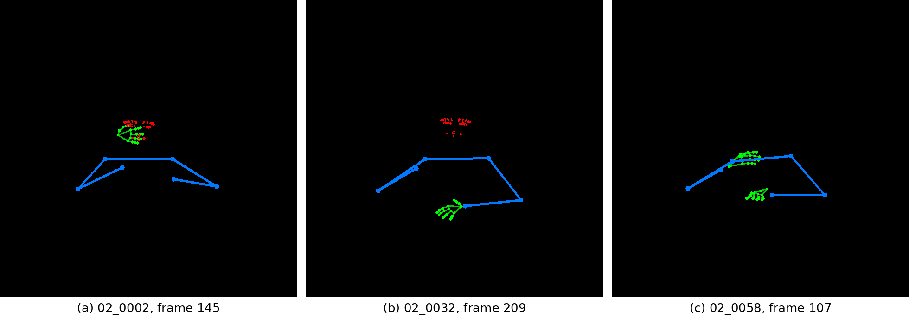

# Tawasil ESL: landmark extraction test (Chapter 7)

This repository holds the code and results behind Chapter 7, "Preliminary Implementation", of the Tawasil ESL report (ITBP 480 Senior Graduation Project I, UAE University, Fall 2026, Group 50, advisor Dr. Farag Sallabi).

Tawasil ESL is a planned Android app that translates Emirati Sign Language (ESL) videos into Arabic text on the phone. This test checks only the first two processing steps of the design, before any sign recognition:

1. **Frame preprocessing (OpenCV):** each frame is resized to one fixed size.
2. **Landmark extraction (MediaPipe):** 21 points on each hand, 6 upper-body points and 45 face points per frame. That is 93 points with 3 values each, so 279 values per frame.

The test does not recognize signs or write Arabic sentences. That work is planned for SGP2.

## Data

The test used three sample sentences from the Isharah dataset (Alyami et al., 2025), which shares each sentence as a folder of frames from a smartphone video. Isharah is used for academic research only, following its terms of use, so **no Isharah frames, videos or landmark files are in this repository**. Only summary numbers and points-only images are shared.

| Sample | Gloss meaning | Frames |
|---|---|---|
| 02_0002 | He is a sign language teacher | 291 |
| 02_0032 | I want to buy a cup | 418 |
| 02_0058 | What time is it now | 214 |

## Results

All 923 frames produced the same 279-value table.

| Sample | One hand found | Both hands found | Body found | Face found | ms per frame |
|---|---|---|---|---|---|
| 02_0002 | 89.3% | 13.4% | 76.6% | 57.4% | 104.5 |
| 02_0032 | 98.3% | 25.1% | 64.1% | 55.0% | 97.6 |
| 02_0058 | 80.4% | 5.1% | 69.2% | 0.0% | 93.4 |

The full numbers are in [`results/summary.csv`](results/summary.csv), and the software versions are in [`results/environment.json`](results/environment.json). The times were measured on a Google Colab CPU, not on a phone.

*Hand (green), body (blue) and face (red) points from one frame of each sample. Only the points are shown, to protect the signer's identity.*

## What the test showed

At least one hand was found in 80.4% to 98.3% of the frames, so MediaPipe could follow the signing hands in these smartphone recordings without a depth camera.

The weak points came from the small 256 x 256 frames, where the hands and face are small:

- Both hands were found together in only 5.1% to 25.1% of the frames.
- No face was found in 02_0058.

Because of this, the SGP2 recordings will use the phone's normal video resolution, with the signer's upper body filling the frame.

## How to run it

1. Open [`notebook/Tawasil_ESL_Level1_Landmarks.ipynb`](notebook/Tawasil_ESL_Level1_Landmarks.ipynb) in Google Colab.
2. Choose `Runtime` > `Run all`.
3. When the upload button appears, upload 1 to 5 short videos, or one .zip file of frame folders (one folder per sentence).
4. When it finishes, a results zip downloads automatically.

The notebook installs MediaPipe 0.10.32 and downloads the hand, pose and face landmark models from Google. It deletes the uploaded videos at the end. Use only videos of people who agreed to be recorded.

## Team

Shamma Mohammed Mufreh Alahbabi, Alsghayra Saeed Obaid Aldhaheri, Noor Ebrhim Ali Almazrouei, Shaikha Hamed Ayed Alahbabi.

## Reference

Alyami, S., Luqman, H., Al-Azani, S., Alowaifeer, M., Alharbi, Y., & Alonaizan, Y. (2025). Isharah: A large-scale multi-scene dataset for continuous sign language recognition. arXiv:2506.03615. https://arxiv.org/abs/2506.03615
